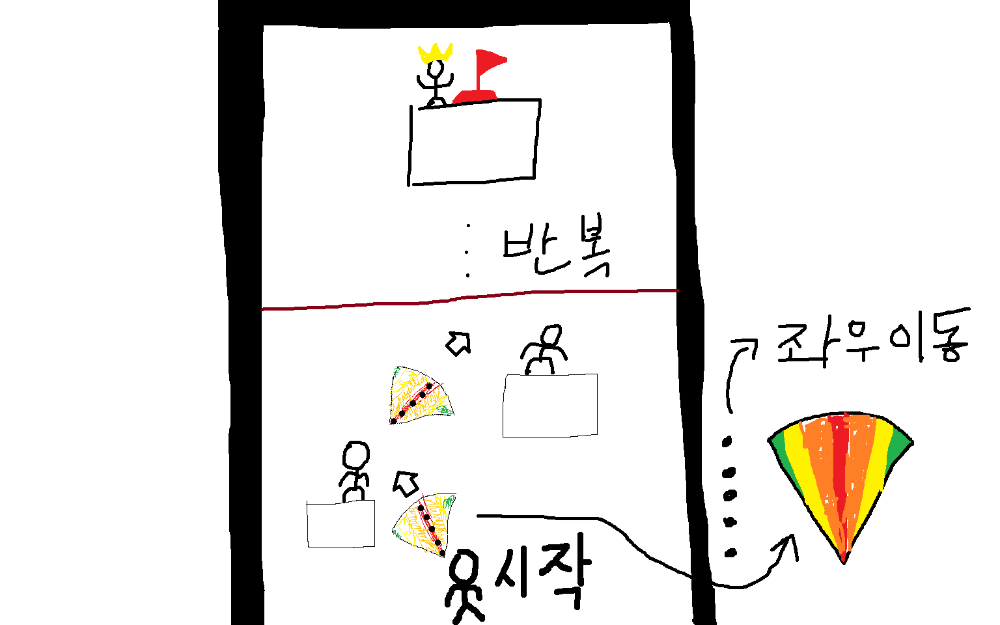

# 📝 게임 기획서

### 3주차 · 보완한 기획서

`WEEK 03` · `기획서 피드백 및 구체화` · `성과물: 보완한 게임 기획서`

2주차 기획서를 Gemini 점검과 튜팅 피드백으로 보완해서 다시 정리합니다. 위쪽 **🤖 Gemini와 기획서 보완하기**를 이용하면 Gemini와 정리한 내용을 이 양식에 바로 채울 수 있어요.

> ✏️ **작성 방법:** 오른쪽 위 연필 ✏️ 아이콘을 누르고 빈칸에 내용을 적은 다음 **Commit changes**를 누르세요.

---

## 1️⃣ 이 게임을 한 문장으로 소개하기

> 예: 고양이가 떨어지는 생선을 받고 폭탄은 피하며 최대한 오래 버티는 게임

**답:** 마우스로 점프할 방향을 결정하고, 부채꼴 모양 점선 게이지를 맞춰 끝까지 올라가는 게임

## 2️⃣ 타깃 플레이어

> 이 게임을 누가 할지 적습니다. 아직 못 정했으면 빈칸으로 둡니다.

**답:** 간단하게 플레이 하고 싶은 사람들

## 3️⃣ 레퍼런스 게임 (2~3개)

| 🎮 게임 이름 | 🏷️ 장르 | 👀 참고하고 싶은 점 |
|---|---|---|
| 점프 킹 (Jump King) | 플랫포머 | 점프하는 모습 |
| 메이플 스토리 - 인내의 숲 | RPG | 상점 구현, 맵 구조 |
| 항아리 게임 |  | 클리어 한 성취감 |

## 4️⃣ 핵심 요소

> 이 게임에서 가장 중요한 재미 요소는 무엇인가요?

**답:** 성공한 짜릿함, 클리어 한 성취감 (ex: 항아리 게임)

---

## 5️⃣ 스테이지 1 만들어 보기

> 📌 게임 전체가 아니라 **첫 번째 스테이지 하나만** 생각합니다. 스테이지 1을 만들려면 무엇이 필요한지 적어 봅니다.

### 5-1. 스테이지 1에서 일어나는 일

| 구분 | 내 게임에서는 |
|---|---|
| ▶️ **시작할 때** | 플레이어가 스테이지 맨 아래에서 등장한다. |
| 🔄 **플레이 중** | 마우스로 플레이어가 어디로 뛸지 결정하고 부채꼴 모양으로 점선이 움직이다가 중앙에 맞출수록 점프랑 안정성이 높아진다. |
| 🏆 **클리어 조건** | 스테이지 끝까지 도달해 깃발을 터치하면 클리어 |
| 💥 **실패 조건** | 캐릭터가 화면에 안 나올 정도로 뛰면 게임오버 |

### 5-2. 스테이지 1에 등장하는 것들

게임 프로그램은 등장하는 것마다 **갖고 있는 정보**와 **하는 행동**으로 이루어집니다. 아래 표가 나중에 내 프로그램의 구조가 됩니다.

| 이름 | 갖고 있는 정보 (예: 위치, 목숨) | 하는 행동 또는 규칙 (예: 이동, 점프) |
|---|---|---|
| 🧍 **플레이어** | 맨 아래 중앙에서 시작하고 캐릭터가 위로 올라가야 한다. | 점프로만 이동 가능, 원하는 곳으로 박자에 맞춰 점프 |
| 깃발 | 캐릭터와 닿으면 스테이지 클리어 | 이동 불가, 무조건 플랫폼 위에 있어야 함 |
| 상인 | 캐릭터가 상인과 가까우면 상점 칸 제공 | 이동 불가, 무조건 플랫폼 위에 있어야 함. |
| 플랫폼 | 캐릭터가 위로 올라갈 수 있다, 좌표값 | 캐릭터가 플랫폼을 통과 할 수 없음. |

> 플레이어 외에 몬스터, 퍼즐, 아이템, 장애물 등 스테이지 1에 꼭 필요한 것만 적습니다. 부족하면 같은 모양으로 줄을 더 추가해도 돼요.

### 5-3. 입력 방식

> 사용할 입력 방식의 `[ ]`를 `[x]`로 바꾸고, 어떤 입력이 어떤 동작이 되는지 적습니다.

- [x] ⌨️ 키보드
- [x] 🖱️ 마우스

| 입력 | 게임 속 동작 |
|---|---|
| 예: 스페이스 키 | 점프 |
| 마우스 | 플레이어의 시야를 지정함. |
| 스페이스 키 | 마우스로 지정하면 리듬게임 형식처럼 박자에 맞춰 올바르게 점프함. |
|  |  |

---

## 7️⃣ 스테이지 1 화면 그림

> 그림판이나 종이에 그린 스테이지 1 화면과, 그 그림으로 Gemini에게 받은 목업을 올립니다.

**✏️ 내 손그림**

**🖼️ Gemini 목업**

_(Gemini 목업을 아직 올리지 않았어요)_

---

🛠️ 4주차에는 이 기획서로 구성요소를 하나씩 만들어요!

